# SynBee user guide

SynBee turns your Synology NAS into the hub of your smart home. It switches Zigbee lights, plugs and switches, reads sensors and remotes, and runs your automations, all on your own NAS. This guide takes you from installing it to building your first automation and giving your family the phone app.

> The pictures in this guide come from a test setup with sample devices. Your own pages show your own devices.

**Contents**

1. [How SynBee works](#1-how-synbee-works): the ideas behind it, in five minutes
2. [What you need](#2-what-you-need)
3. [Install SynBee](#3-install-synbee)
4. [Sign in](#4-sign-in)
5. [Connect the gateway](#5-connect-the-gateway)
6. [Add devices](#6-add-devices)
7. [Rooms](#7-rooms)
8. [Control a device](#8-control-a-device)
9. [Light groups](#9-light-groups)
10. [Actions: one tap for several devices](#10-actions-one-tap-for-several-devices)
11. [Automations: WHEN, IF, THEN](#11-automations-when-if-then)
12. [Sensor groups and checks: is everything OK?](#12-sensor-groups-and-checks-is-everything-ok)
13. [The phone app for your family](#13-the-phone-app-for-your-family)
14. [Alerts on your phone, and notifications](#14-alerts-on-your-phone-and-notifications)
15. [Keep your gateway safe](#15-keep-your-gateway-safe)
16. [Backups, updates and the Status page](#16-backups-updates-and-the-status-page)
17. [Questions and problems](#17-questions-and-problems)

---

## 1. How SynBee works

**Zigbee** is a low-power radio used by many smart lights, plugs, switches and sensors, from many brands. Zigbee devices don't use your Wi-Fi: they talk to a **gateway** (also called a coordinator), a small box with a Zigbee radio. Mains-powered devices, such as plugs and bulbs, pass messages on for others, so the network reaches further the more of them you have.

SynBee is made of three parts:

| Part | What it is | Where it lives |
| --- | --- | --- |
| **The hub** | The SynBee app on your NAS. It knows every device, runs your automations and keeps all data. You set it up in your browser. | Your Synology NAS |
| **The gateway** | A network Zigbee radio, such as an SMLIGHT SLZB-06M, plugged into your router. SynBee talks to it over your home network. | Anywhere in your home, ideally central |
| **The phone app** | SynBee for Android, for the people who live in your home. They tap actions and see what is on. They can't change any settings. | Your family's phones |

The words you will meet in SynBee:

- **Device:** one Zigbee light, plug, switch, sensor, remote, lock or valve.
- **Room:** where a device is. Rooms only organise: they never switch anything by themselves.
- **Light group:** several lights switched together, in one radio message.
- **Action:** a named list of steps, such as "Movie time: living room lights to 15 %, warm". You run it with one tap, from the browser or the phone app.
- **Automation:** a rule that runs by itself: **WHEN** something happens, **IF** something is true, **THEN** do some steps. For example: when the hall motion sensor sees movement, if it is dark, turn on the hall light for 5 minutes.
- **Sensor group:** several yes/no sensors of one kind read as one state, such as "Windows: all closed".
- **Check:** a statement you define, such as "Ready to leave" or "OK to heat", built from conditions. It is true or false, in your own words.
- **Status tile:** a tile in the phone app that shows how something is ("21.4 °C", "Windows: all closed"), next to the actions.
- **App user:** a person who uses the phone app. You choose what each may use and see.

**Nothing leaves your network.**¹ SynBee needs no account, no cloud and no internet connection. Your devices and automations keep working when the internet is down.

¹ Except when you choose to use the phone app away from home: then the app's requests travel over the internet to your NAS, encrypted and accepted only by your own SynBee ([section 13](#using-the-app-away-from-home)), and, if you set up alerts to Synology Chat, the notification Synology's push service delivers to your phone ([section 14](#alerts-on-your-phone-through-synology-chat)).

## 2. What you need

- **A Synology NAS** with DSM 7.2 or later. Intel and AMD models are supported (a package for 64-bit ARM models is built, but not yet tested on hardware).
- **A network Zigbee gateway** with EmberZNet firmware, such as the **SMLIGHT SLZB-06M** or **SLZB-06MU**, connected to your router with a cable. Give it a fixed address in your router (a "DHCP reservation"), so it keeps its address.
- **Zigbee devices.** Most devices of most brands work: SynBee supports everything [Zigbee2MQTT supports](https://www.zigbee2mqtt.io/supported-devices/).
- About 250 MB of space on the NAS.

> **Coming from a Tuya, Aqara or other vendor app?** Your devices must join SynBee's own Zigbee network, one at a time. From a Tuya gateway, SynBee can bring over their names, rooms and automations first: see [Importing from Tuya](import-from-tuya.md). Read the [transition risks](pitfalls.md#transition-risks) before you start.

## 3. Install SynBee

1. Download the SynBee package for your NAS: `synbee-<version>-x86_64.spk` for Intel and AMD models.
2. In DSM, open **Package Center**, choose **Manual Install**, and select the file.
3. DSM says the package isn't from Synology. Read it and choose **Agree** to continue.
4. The install wizard asks for a few things:
   - **Before you install:** read the disclaimer, and tick the box. SynBee is free and comes without warranty.
   - **Where to keep data:** a shared folder for SynBee's data (devices, rooms, actions, automations and history). The default `synbee` is fine. Keys never go into it; they stay in SynBee's private folder.
   - **Ports:** keep the defaults, **8090** for the web interface and **8443** for the phone app.
   - **Zigbee coordinator:** your gateway's address and port, for example `192.168.1.30:6638`. You find both on the gateway's own web page. You can also leave it empty and set it later.
5. Finish the wizard. SynBee starts by itself.

## 4. Sign in

Open **SynBee** from the DSM main menu, or go to `http://<your NAS's address>:8090` in your browser.

The first time, SynBee asks you to **choose an admin password** (at least 10 characters). This password protects all of SynBee's settings; write it down somewhere safe.

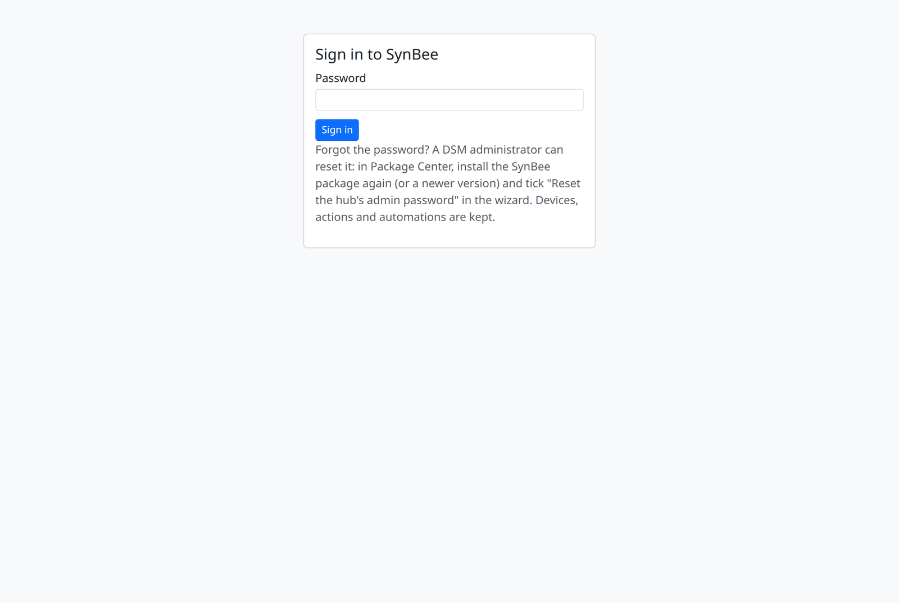

The bar at the top has the everyday pages: **Devices, Rooms, Actions, Automations, Groups, Checks** and **App users**. Setting up the hub is under **Administration**: **Add devices, Import from Tuya, Gateway** and **Status**.

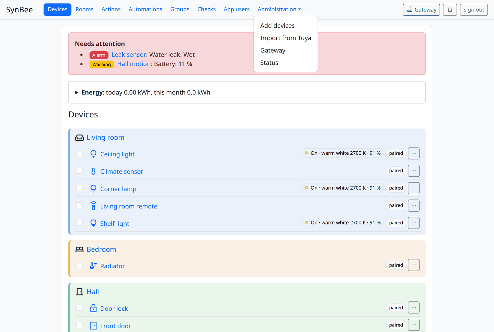

> **Forgot the password?** In Package Center, install the SynBee package again (or a newer one) and tick **Reset the hub's admin password** in the wizard. Your devices, actions and automations are kept.

SynBee works only on your home network. Opening it from outside your home is refused, on purpose.

## 5. Connect the gateway

Open **Administration → Gateway**. When SynBee reaches your gateway, it shows **connected** in green, and the **Gateway** light in the top right corner of every page is green too.

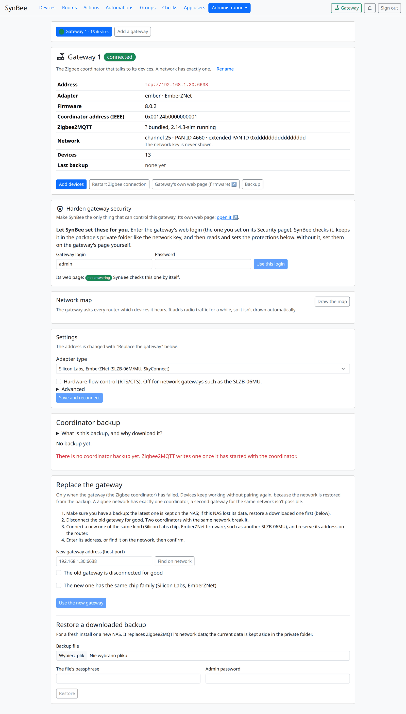

Here you see your Zigbee network: its address, firmware, radio channel and the number of devices. If you left the address empty during installation, enter it here.

Do two things right after connecting:

1. **Download a backup.** Under **Coordinator backup → Download a copy**, choose a passphrase (at least 12 characters), enter your admin password, tick that you understand the file holds your network's key, and download. Keep the file somewhere other than the NAS (a USB stick, your computer). If the NAS or the gateway ever breaks, this file brings your whole Zigbee network back, without pairing every device again.
2. **Make the gateway safe:** see [section 15](#15-keep-your-gateway-safe).

> **Only one program may use the gateway.** If anything else was connected to it (Home Assistant, another Zigbee2MQTT), switch that off first.

## 6. Add devices

Open **Administration → Add devices**, choose how long to wait (10 minutes is plenty), and press **Start waiting**. Then put your device in pairing mode, as its manual says: usually by holding its button for 5 seconds, or switching a bulb on and off a few times.

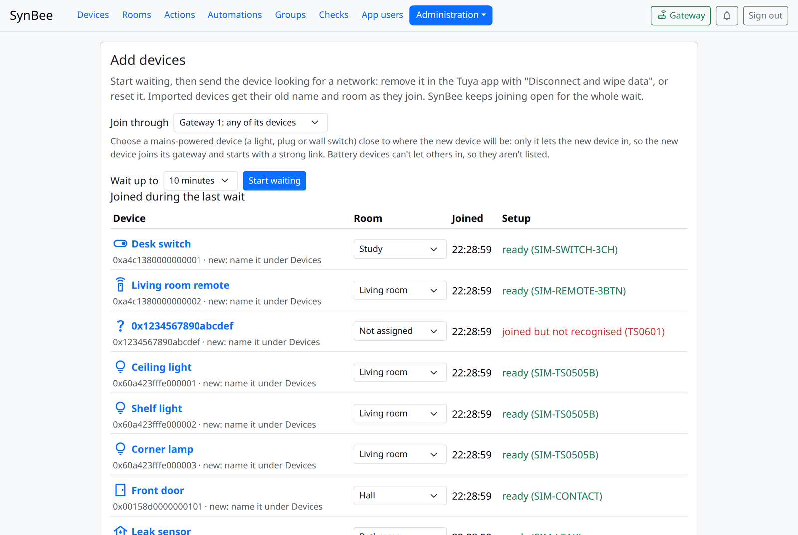

Each device appears in the list as it joins. When it says **ready**, give it a room right there. Give it a name on its page later: open it from the **Devices** page, type the name and choose **Save name**.

Tips:

- **Join through:** by default, a device can join through any mains-powered device of your network. To pair a device in a far corner, choose a light or plug close to it; then only that one lets it in, and the new device starts with a strong connection.
- **Battery devices** (sensors, remotes) fall asleep quickly. If one shows "joined but not recognised", press its button to wake it, open it on the Devices page and choose **Read its details again**.
- **Pair mains-powered devices first,** starting near the gateway and moving outwards. Each one makes the network stronger for the next.

## 7. Rooms

Open **Rooms** to add your rooms: type a name, press **Add room**, then pick an **icon and colour**. You can also add a photo of the room.

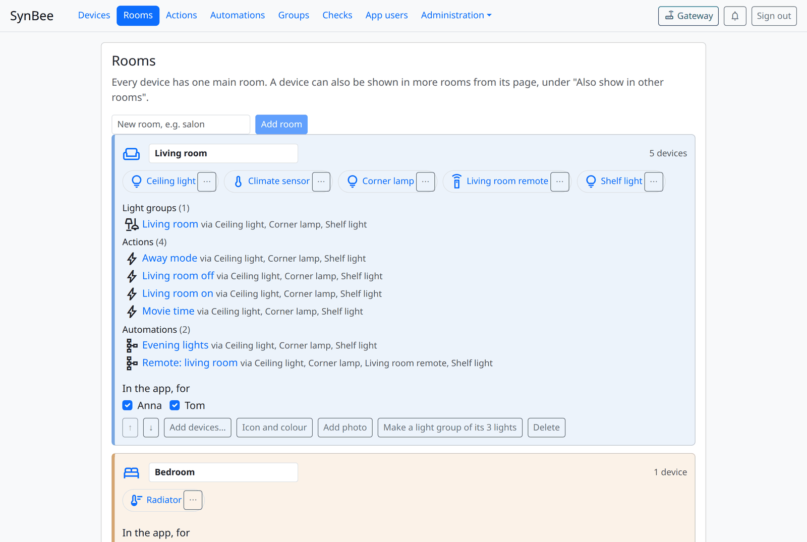

- **Every device has one main room.** Move a device with the **⋯** button next to it, or choose several devices on the Devices page and move them together.
- **A device can also be shown in other rooms,** for example a hall light that you also want in the living room's list.
- Each room lists its devices, light groups, actions and automations, so you see at a glance what belongs where.
- **"In the app, for"** chooses which app users see this room.
- **Make a light group of its lights** creates a light group from all the room's lights at once.

Rooms only organise. Moving a device to another room never changes what an action or automation does.

## 8. Control a device

The **Devices** page lists all devices by room. Anything that needs your attention, such as a leak, a low battery or a device that stopped answering, is shown at the top, alarms first.

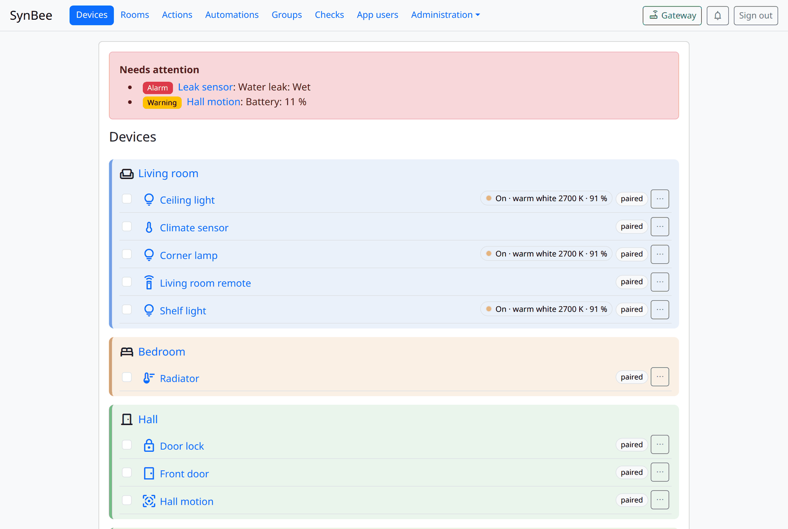

Open a device by clicking its name. The device page shows its controls, built from what the device can do: on and off, brightness, white temperature, colour, and its sensor readings.

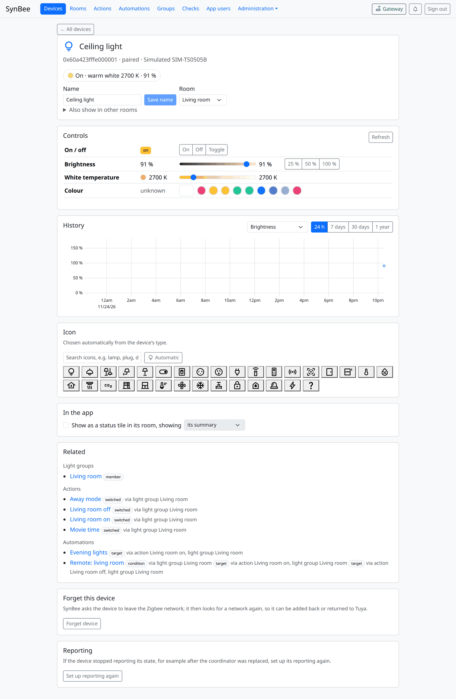

Further down you find:

- **Settings** and **Diagnostics** of the device, folded away;
- **History:** a graph of each reading over a day, a week, a month or a year;
- **Related:** the actions, automations and light groups that use this device;
- its **name** (**Save name**), **Refresh**, and **Forget** (removes the device from your network).

A sensor's page shows its readings and their history:

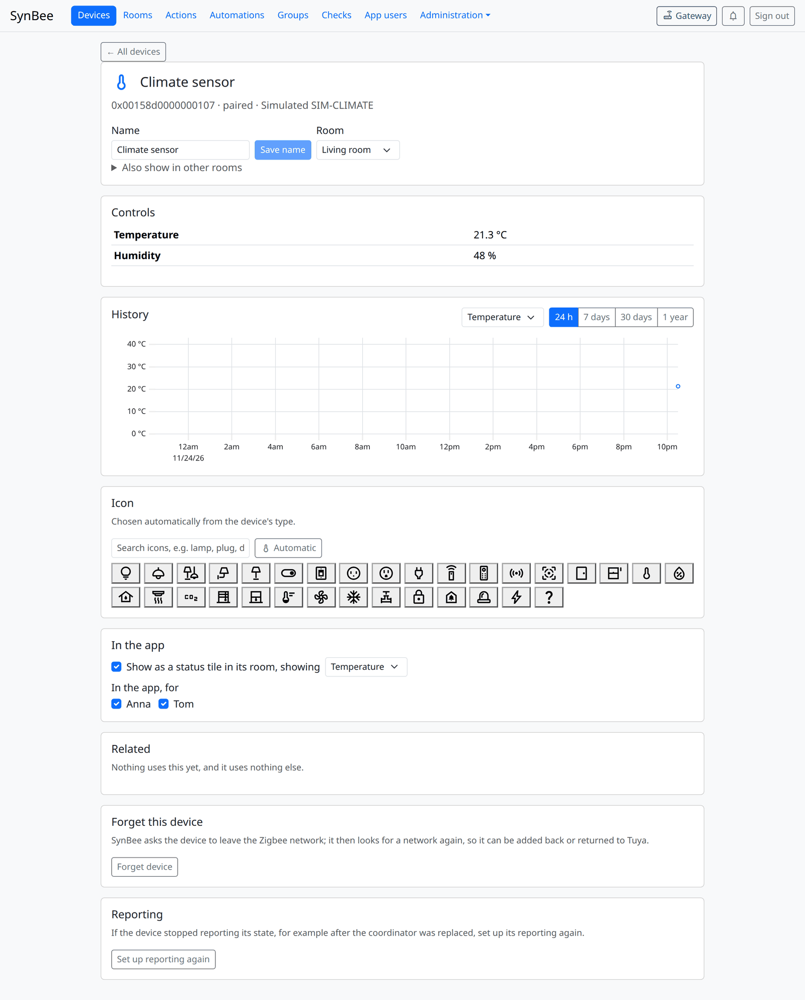

> **Door locks** ask you to confirm before unlocking, everywhere in SynBee.

## 9. Light groups

A **light group** switches several lights together, in one radio message, so they change at the same moment. Open **Groups → Light groups** and choose **New group**, or use **Make a light group of its lights** on the Rooms page.

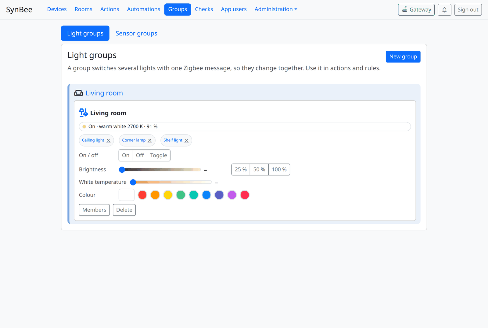

Use a light group wherever you want "all the living room lights": in actions, in automations, and from the group's own controls. You can add and remove lights later.

## 10. Actions: one tap for several devices

An **action** is a named list of steps you run with one tap: "Movie time", "Good night", "Everything off". Each step sets a device or a light group: on or off, brightness, colour, and so on.

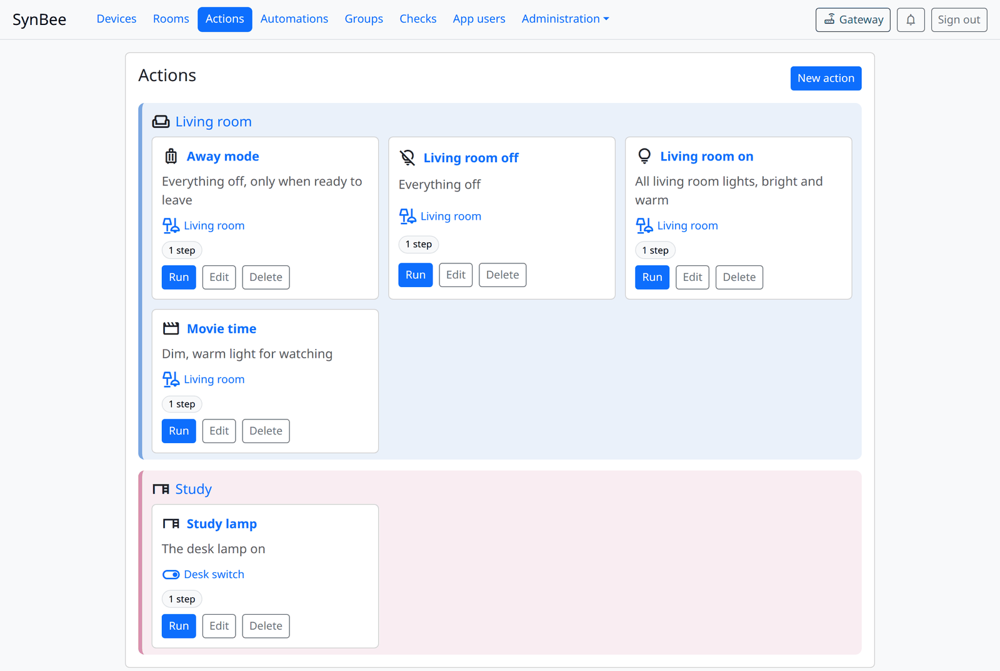

To create one:

1. Open **Actions** and choose **New action**.
2. Give it a **name**, an **icon** and, if you like, a short description.
3. Add **steps**: choose a device or light group, then what to set. For example "Living room lights: on, brightness 15 %, white 2200 K".
4. **Save**, then press **Run** to try it.

Steps run in order. If a device doesn't answer, the action stops there and tells you which device it was.

**Only when.** An action can check something before it runs. Under **Only when (IF)** on the action's page, add conditions, the same as in automations: a device's value, a sensor group, a check, the time, whether it is dark. If they don't hold when someone taps the action, nothing runs, and they see why, for example "Not run: "Ready to leave" isn't true".

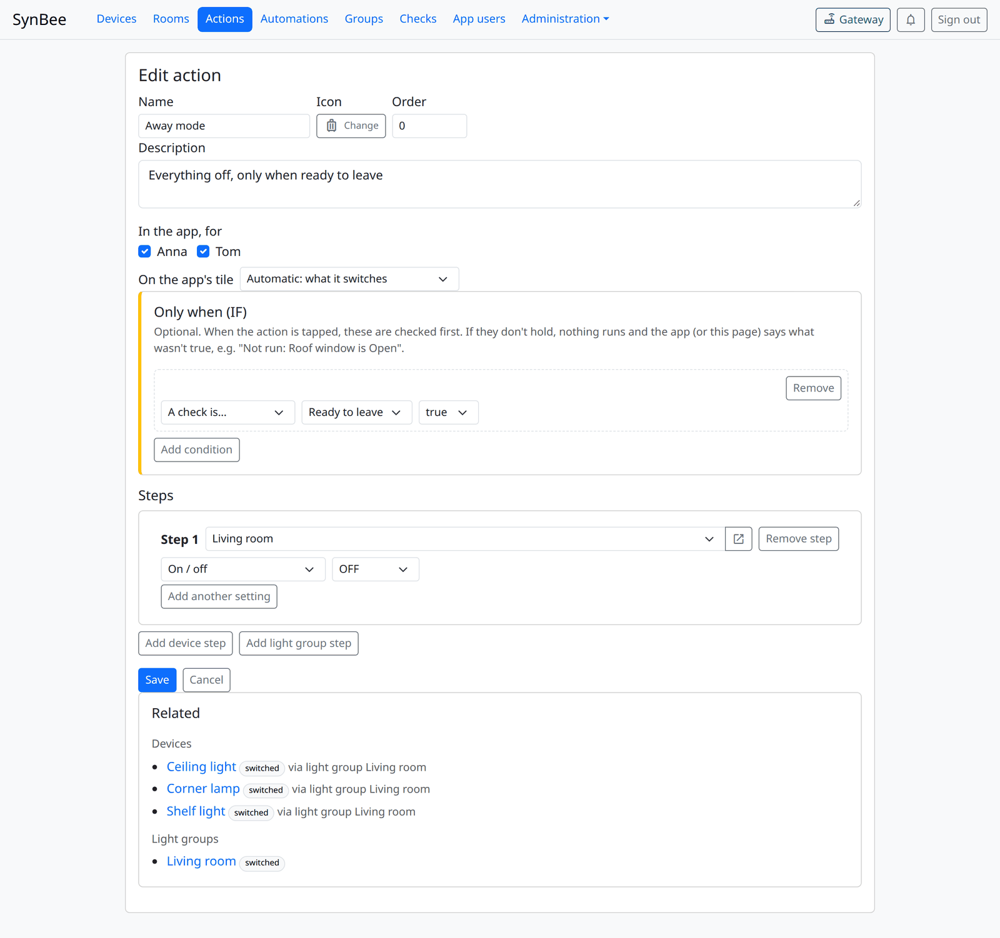

Actions are also how your family switches things from the phone app, and automations can run them too. So define a scene once, as an action, and use it everywhere.

## 11. Automations: WHEN, IF, THEN

An **automation** runs by itself. It reads like a sentence:

- **WHEN** something happens (any one of the events you add),
- **IF** something is true (all, or any, of the conditions you add; optional),
- **THEN** do these steps, in order.

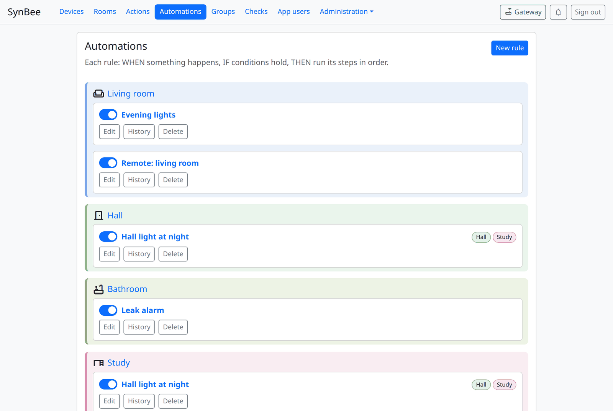

### Example: hall light at night

"When the hall motion sensor sees movement, if it is dark, turn the hall light on, and off again 5 minutes later."

1. Open **Automations** and choose **New rule**. Name it "Hall light at night".
2. **WHEN:** choose **A device changes**, then **Hall motion**, **Motion**, **becomes** **Motion**.
3. **IF:** choose **Add condition**, then **It is dark or light** and **dark (sunset to sunrise)**.
4. **THEN:**
   - Step 1: **Set a device**, choose the light, **On / off: ON**.
   - Step 2: **Start a timer**, after **5** minutes, **set a device**, the same light, **OFF**. If someone walks by again, the countdown starts again, so the light stays on while there is movement.
5. **Save and test** runs the steps once, now, so you can check them.

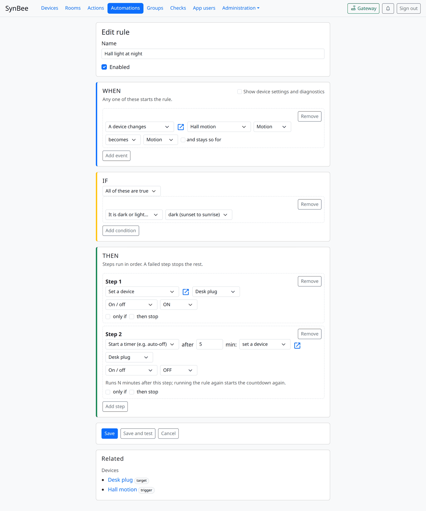

### What else automations can do

| WHEN | IF | THEN |
| --- | --- | --- |
| A remote button is pressed (single, double, long) | A device has a value (above, below, between…) | Set a device or a light group |
| A device changes ("and stays so for 10 minutes") | A time window, or certain weekdays | Wait some seconds |
| A time of day, on chosen weekdays | It is dark, or light | Start a timer (auto-off) |
| Sunrise or sunset, earlier or later | A light group is on, off or partly on | Run an action |
| Every N minutes | A sensor group is all closed, some open, all open | Send yourself a notification |
| An action is run, or another automation's event | A check is true, or false | Send an event to another automation |
| A sensor group changes ("and stays so for 5 minutes") | | |
| A check becomes true or false ("and stays so for 10 minutes") | | |

- **Each step can have its own "only if".** Together with **then stop**, one remote button can switch a light on when it's off, and off when it's on:

  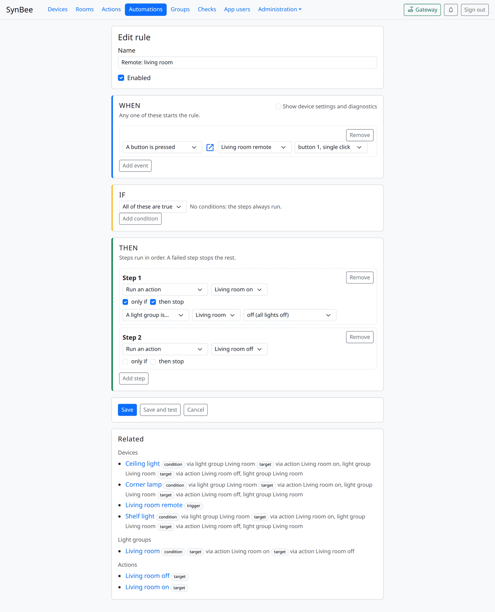

- **Look like someone is home:** times and sunset can move by a random amount each day, up to an hour.
- **Sunrise and sunset** are calculated on the NAS from your home's location, which you set once on **Administration → Status**. No internet is needed.
- **Notification texts can say what happened.** Write, for example, "{device} is {state} for {duration}" and it arrives as "Balcony door is Open for 5 min". You can use {device}, {state}, {duration}, {check}, {why}, {rule} and {time}.
- **History:** each automation keeps a list of its recent runs: when, why, and what each step did, or why it was skipped. If an automation didn't do what you expected, look there first.

## 12. Sensor groups and checks: is everything OK?

### Sensor groups

A **sensor group** reads several yes/no sensors of one kind as one state: all your window contacts, every leak sensor, all door locks. Open **Groups → Sensor groups → New sensor group**, give it a name, and tick its sensors.

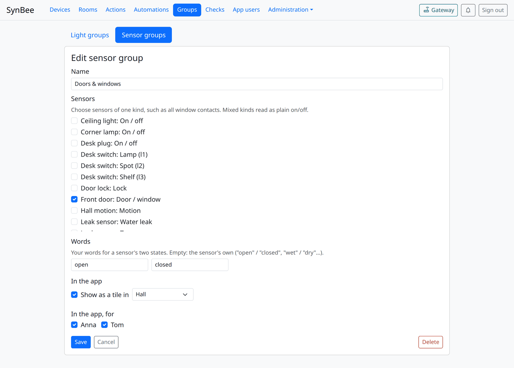

- It reads in words: one sensor as its state ("Closed"), several as "All closed", "All 3 open" or "2 of 5 open: Kitchen, Hall".
- **Words:** write your own words for the two states, such as "otwarte" and "zamknięte". Left empty, SynBee uses the sensor's own ("open" / "closed", "wet" / "dry").
- **In the app:** choose the room whose page shows it as a tile, and which people see it.

### Checks

A **check** is a statement you define from conditions, such as "Ready to leave: all doors and windows closed and the front door locked". Open **Checks → New check**:

1. Give it a name, such as "Ready to leave".
2. Under **True when**, add its conditions: a sensor group ("Doors & windows is all closed"), a device's value ("Door lock is locked"), the time, whether it is dark…
3. Under **What it means**, write what true and false mean to you, and how each looks: fine (green), info (grey), warning (orange) or alarm (red). For example true "Ready: closed and locked" (fine), false "Not ready" (warning).
4. Choose the room for its tile in the app, and who sees it.

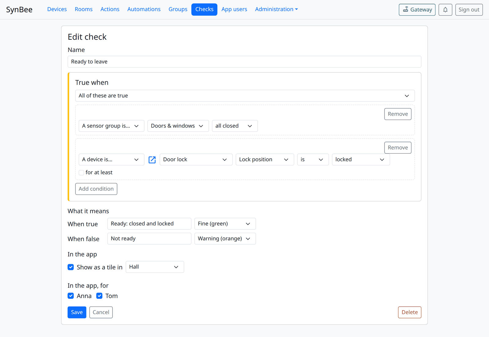

The Checks page shows each check's state now, and why:

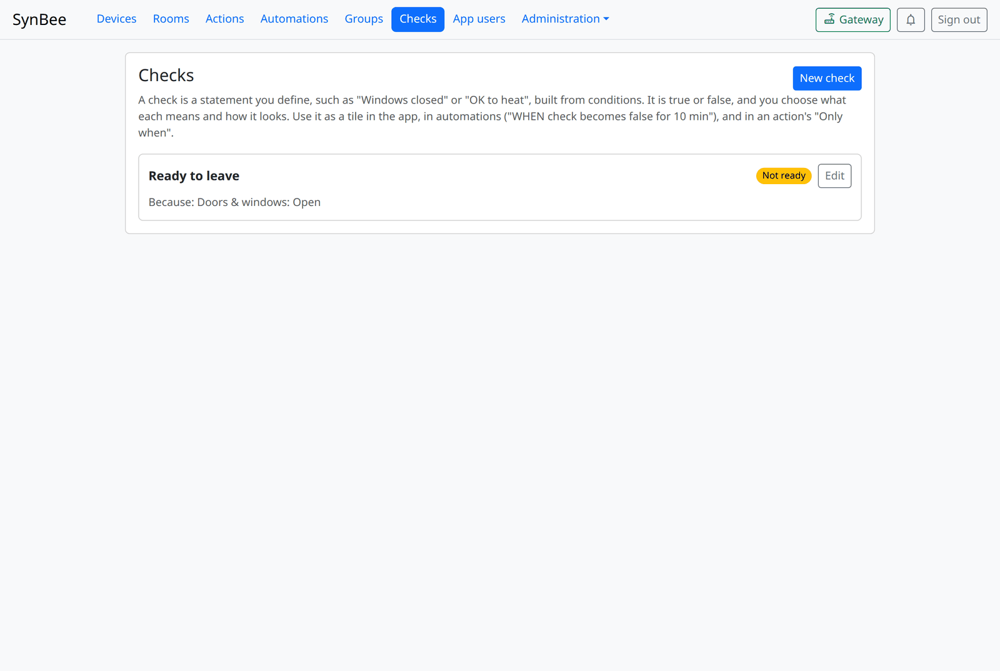

Use checks everywhere:

- **As a tile** in the phone app, in your words and colours.
- **In automations:** "WHEN Ready to leave becomes false and stays so for 10 minutes, THEN notify me".
- **In an action's Only when:** "Away mode" runs only when "Ready to leave" is true, and otherwise says why.

### Status tiles for single devices

On a device's page, under **In the app**, tick **Show as a status tile in its room** and choose what it shows: its summary or one reading.

- **Yes/no readings** (a door, a leak) can have your own words for their two states.
- **Numbers** show with their unit. Temperatures are coloured from blue (cold) through green to red (hot); CO₂, fine dust and a low battery turn orange or red when they need attention.
- Choose who sees it under **In the app, for**.

## 13. The phone app for your family

The **SynBee app for Android** shows each person their rooms and actions, as tiles to tap. It can't change any settings: you decide everything here.

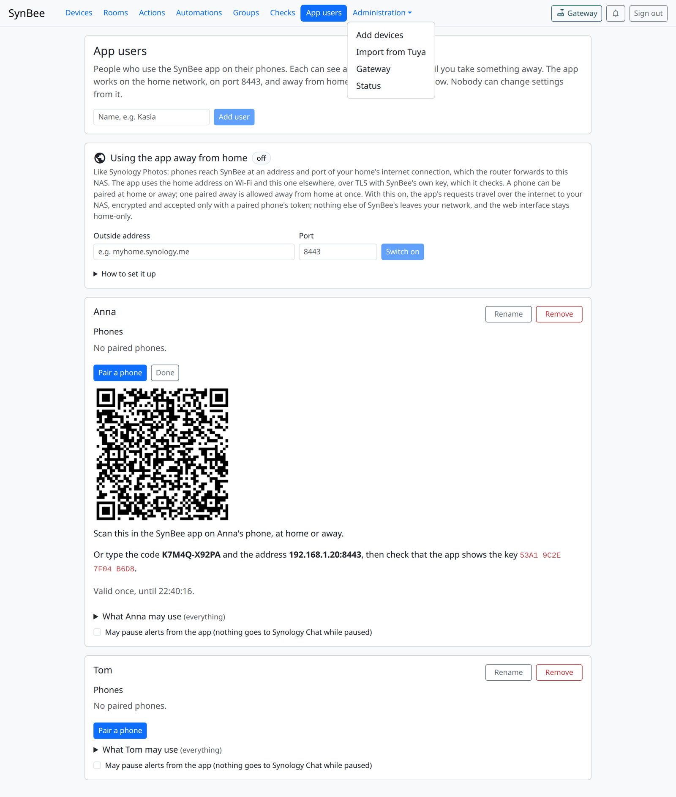

### Add a person and pair their phone

1. Open **App users**, type the person's name and press **Add user**.
2. Press **Pair a phone** next to their name. A QR code appears, valid once, for 10 minutes.
3. On their phone, install **SynBee** from Google Play, open it and tap **Scan the QR code**. Point the camera at your screen.
4. The phone shows their rooms and actions. Done.

You can also type the address and the code shown under the QR code instead of scanning it; the app then shows a key to compare with the one on this page.

### Choose what each person may use

Open **What … may use** under a person. Everything is allowed until you untick it: a whole room, or single actions. A device is visible when its room is. New rooms and actions are allowed automatically. Status tiles have their own **In the app, for** ticks, on the page of each device, sensor group and check.

Tick **May pause alerts from the app** for people who may silence your alerts for a while (see the next section).

### A lost phone

Press **Revoke** next to the phone. It stops working at once. To remove a person and all their phones, press **Remove**.

### Using the app away from home

At home, the app talks to SynBee over your Wi-Fi. To use it on mobile data too, as Synology Photos does:

1. **On your router,** forward one port (8443, TCP) to your NAS. Never forward 8090, the web interface.
2. **In DSM** (Control Panel → External Access → DDNS), you can get a free name such as `myhome.synology.me`, which keeps working when your home's internet address changes.
3. **In SynBee,** under **Using the app away from home**, enter that name (or your internet address) and the port, and choose **Switch on**.
4. **For each phone** that may be used away from home, switch on **Away from home** next to it. A phone paired while away from home has it on already.

With this on, the app's requests travel over the internet to your NAS, encrypted, and are accepted only from paired phones. Everything else stays in your network, and the web interface stays home-only.

## 14. Alerts on your phone, and notifications

- **Needs attention** at the top of the Devices page lists alarms (water leak, smoke, gas), warnings (low battery, tampering, an unlocked lock) and devices that stopped answering.
- **The bell** in the top right corner opens your notifications: alarms, a lost gateway, and the notifications your automations send. It turns red when an alarm is unread.

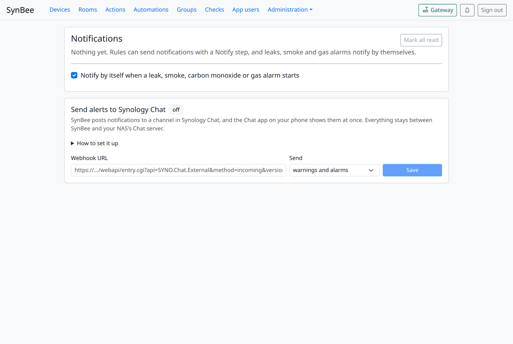

### Alerts on your phone through Synology Chat

SynBee can send its notifications to a channel in **Synology Chat**, which runs on your NAS; the Synology Chat app then shows them on your phone at once.

1. Install **Synology Chat Server** from Package Center, and the **Synology Chat** app on your phone.
2. In Chat, create a channel, such as "Home alerts". Click your profile picture → **Integration → Incoming Webhooks → Create**, choose the channel, and copy the **Webhook URL**.
3. In SynBee, open the bell → **Send alerts to Synology Chat**, paste the URL, choose what to send (alarms only, warnings and alarms, or everything), and **Save**. Press **Send a test**.

From then on, alarms, a lost gateway and your automations' notifications at that level arrive in Chat. SynBee keeps every notification in its own list too. The Chat app's notification reaches your phone through Synology's push service, like the notifications of Synology's other apps; the message itself stays in Chat on your NAS.

**Pausing alerts.** People you allow (App users → **May pause alerts from the app**) can pause alerts in their app for an hour, eight hours or until 7:00. While paused, nothing goes to Chat; the Notifications page says who paused and until when, with **Resume now**.

### Example: the balcony door left open

WHEN the balcony door **becomes Open** and **stays so for 5 minutes**, THEN **Send a notification**, level **Warning**, text "{device} is {state} for {duration}". If you close the door sooner, nothing is sent.

- **History:** every sensor reading is kept, for two years as hourly averages. Open a device to see its graphs. Devices that measure energy show kWh per day, and the Devices page shows your total.

## 15. Keep your gateway safe

A network gateway obeys anyone on your network who connects to it, and its own web page may have no password. On **Administration → Gateway → Harden gateway security**, SynBee helps you close those doors:

1. On the gateway's own web page (link on the card), set a **password** for its web page, under Security.
2. In SynBee, enter that login under **Let SynBee set these for you** and choose **Use this login**. SynBee keeps it privately on the NAS.
3. SynBee now shows each protection, with a button to switch it on:
   - **Only this NAS can talk to the radio:** nobody else on your network can take over your Zigbee network. If SynBee loses the gateway two minutes after this change, it undoes it by itself.
   - **Its recovery Wi-Fi has a password:** when the gateway loses its network, it opens its own Wi-Fi for setup; this stops strangers joining it.
   - **Its own MQTT and Home Assistant features are off:** SynBee doesn't need them.
   - **Its web page off while SynBee is connected** (optional, strictest): the gateway's page then works only while SynBee is stopped, and SynBee can't change these settings either until you switch it off on the gateway.

If SynBee loses the connection to the gateway, the Gateway light turns red, and after two minutes you get a notification.

## 16. Backups, updates and the Status page

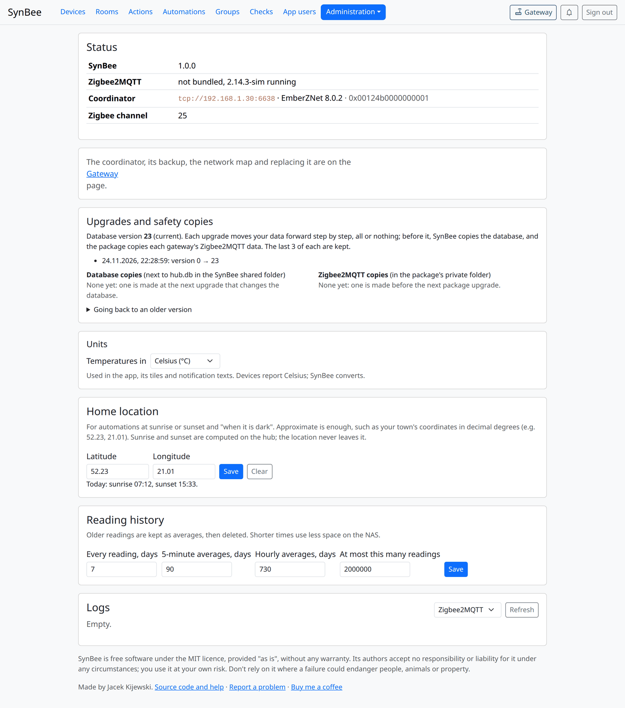

- **Your data** (devices, rooms, actions, automations, history) is in the shared folder you chose. Back it up with DSM's **Hyper Backup** like any other folder.
- **Your Zigbee network** (the gateway's backup, with its key) is not in that folder, on purpose. Download it from the Gateway page after setting up, and again after adding many devices.
- **Updating SynBee:** download a gateway backup first. Then install the newer package with **Manual Install**. Everything is kept. Before changing anything, SynBee saves a copy of its database and of the Zigbee data; **Status → Upgrades and safety copies** lists them and explains how to go back.
- **Location:** set your home's approximate location on the Status page, for sunrise and sunset automations.
- **Units:** choose whether temperatures show in Celsius or Fahrenheit, in the app, its tiles and your notification texts.
- **Logs:** if something misbehaves, the Status page shows the logs of SynBee and of the Zigbee radio, with keys and passwords hidden.

## 17. Questions and problems

**A device doesn't join.** Make sure Add devices is waiting, and the device is close to the gateway or a mains-powered device. Reset it again as its manual says. Some devices need the button held for 10 seconds or more.

**A device shows "not recognised".** Open it and choose **Read its details again** while it is awake (press a button on battery devices). If it still isn't recognised, it may not be supported yet.

**A device stopped answering.** Check its power or batteries. Battery devices report only now and then, so they may look quiet for a while. A mains-powered device far from others may need a plug or bulb in between.

**The Gateway light is red.** Check that the gateway has power and its network cable, and that its address hasn't changed. On the Gateway page, **Restart Zigbee connection**.

**An action says "Not run".** Its **Only when** conditions didn't hold; the message says which. Change the conditions on the action's page if they're not what you want.

**No alert arrives in Synology Chat.** Press **Send a test** on the Notifications page. If it fails, the message says why; if it works, check the level you chose, and whether someone paused alerts.

**An automation didn't run.** Open it and look at its history: it says whether it ran, was skipped (and which condition wasn't met), or failed (and which device didn't answer).

**The phone app says it can't reach the hub.** At home: check the phone is on your Wi-Fi. Away: check "Using the app away from home" is on, the phone's "Away from home" is on, and your router forwards port 8443.

**Something else?** Report it at [github.com/jkijewski/synbee/issues](https://github.com/jkijewski/synbee/issues) or write to jacek.kijewski.gdynia@gmail.com. If SynBee is useful to you, you can [buy me a coffee](https://buycoffee.to/jacek-kijewski).

---

SynBee is free software under the MIT licence, provided "as is", without any warranty. Don't rely on it where a failure could endanger people, animals or property. See [DISCLAIMER](../DISCLAIMER.md).
